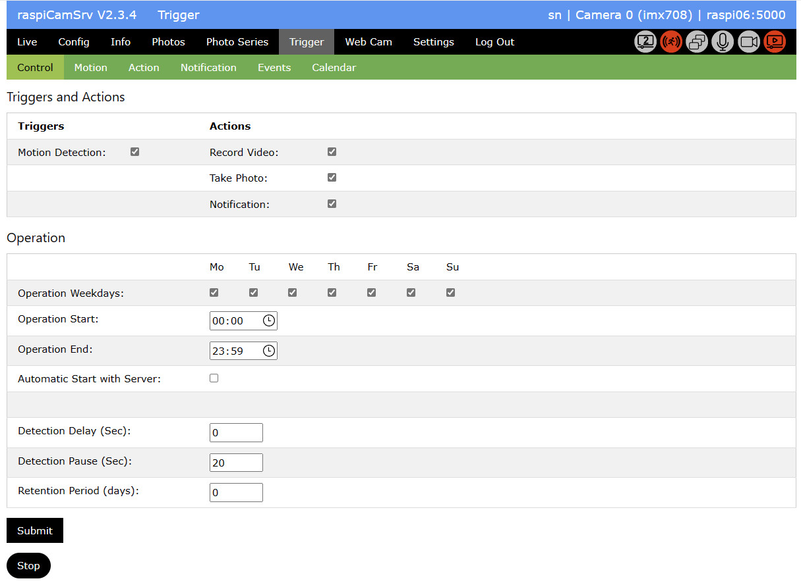
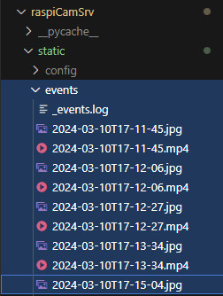
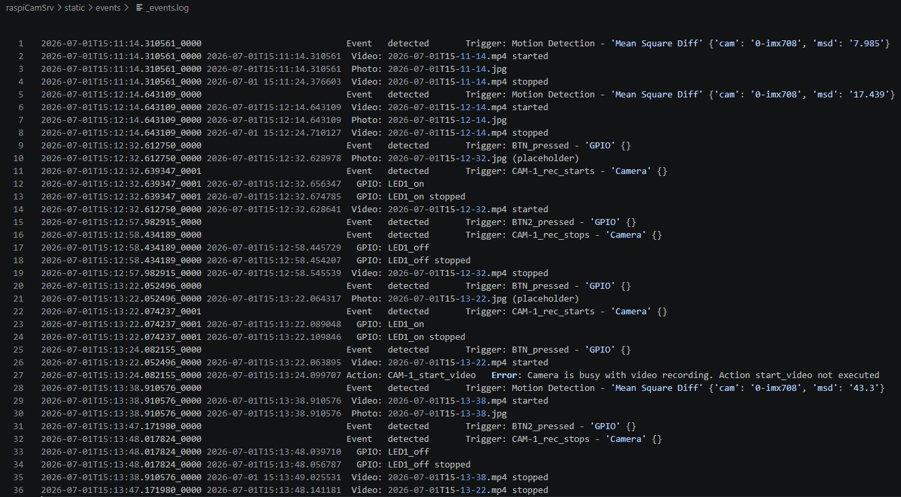
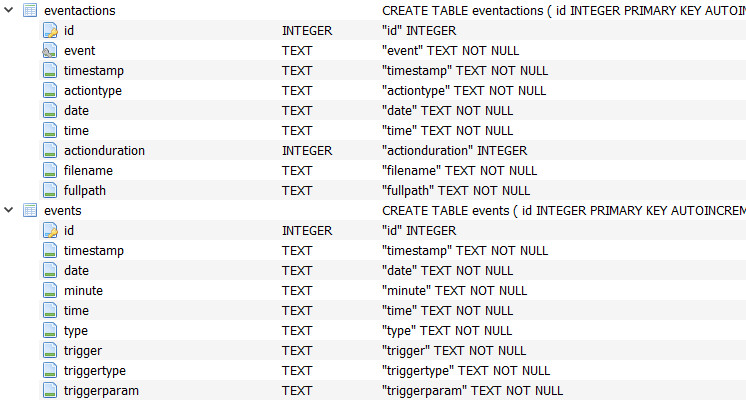
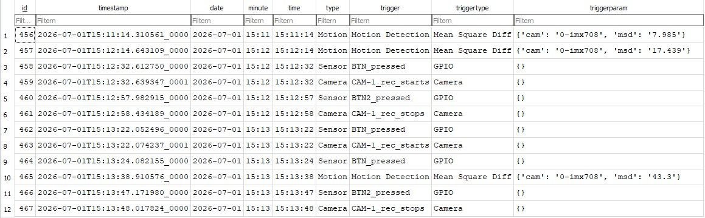
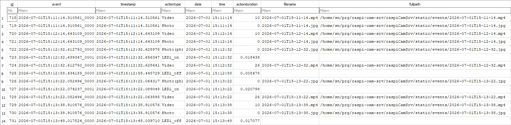

[](./TriggerOverview.md)

# Active Event Handling and Motion Capturing

The *Start* button on the *Control* page starts the trigger handling process.



You can choose to activate pure Motion Capturing, pure capturing of [Trigger](./TriggerTriggers.md) events or both

An active capture process is indicated with red [Process Status Indicators](./UserGuide.md#process-status-indicators) for both types.

The *Start* button has changed to *Stop*, which allows stopping the process.

If motion capturing and/or Trigger handling is currently active but operation paused because of schedule settings, this is indicated by yellow process status indicators:


## Event Data

Event data are stored in directory ```./prg/raspi-cam-srv/raspiCamSrv/static/events```:



Storage includes a log file as well as video and photo files.

**NOTE**:     
For Motion Capturing, event data and related media (photos, videos) will always be located here.    
For events originating from configured [Triggers](./TriggerTriggers.md), this is only the case if their *Control* parameter set includes ```event_log: True``` (See [Control](./TriggerTriggers.md#control)).

## Parallel Activities

While motion capturing is active, the live stream process will be kept active because this is used for motion detection.

While motion capturing is active, you may continue working with **raspiCamSrv**.   
You may even take photos, videos or photo series.

However, you should avoid changing camera controls or configuration because this might restart the camera.

### Dos and Don'ts

#### Blocked:

- Changing [Settings](./Settings.md)
- Starting a [Exposure Series](./PhotoSeriesExp.md) or a [Focus Stack Series](./PhotoSeriesFocus.md)
- Changing [Camera Configuration](./Configuration.md)

#### Changing Zoom

This can be done while motion capturing is active.   
However the moment when the new zoom setting is activated will be registered as motion event.

#### Changing Focus

To improve the focus for camera model 3, you may change [Focus Settings](./FocusHandling.md) and [Trigger Autofocus](./FocusHandling.md#trigger-autofocus)

#### Changing Camera Controls

In order to change the quality of videos and photos, you may change any [Camera Controls](./CameraControls.md) while motion capturing is active.

## Log File

While events are registered and videos and photos are taken, the system maintains a log file (```static/events/_events.log```) with entries for all events and the times when photos are captured or videos are started and stopped:



The log file of the above screenshot shows examples for:

- (lines 1 to 8): detection of motion  with a 10 sec video being recorded and a placeholder photo being taken.    
- (lines 9 to 19): a physical button (BTN) being pressed (line 9) which starts video recording (line 14) and placing a placeholder photo (line 10), which is done before starting recording.
<br>When the camera starts recording, another trigger fires (line 11) on which a LED is switched on (lines 12-13).
<br>Later (line 15), another physical button (BTN2) is pressed, which stops recording (line 19).
<br>When recording stops, a Camera trigger fires (line 16) on which the LED is switched off (lines 17-18)
- (lines 25, 27) show an example where button BTN was pressed but where the associated action to start recording could not be executed because the camera was already active at this time.

The fact that the Camera triggers fire, before the associated camera action start/stop is completed, is due to the fact that the latter operations require some time-consuming preparation and cleanup activities.

### Event ID and Timestamps

While Motion Detection will hardly require subsecond discrimination, this is different for events from GPIO-related input devices.

In order to be able to uniquely identify events, the event key
<br>(e.g. ```2026-07-01T15:12:32.612750_0000```)
<br>is built from

- a time part with microsecond precision
- extended with a counter which is zeroed once within a second and then incremented for each event occurring in the same second (see lines 9, 11 of the [Log File](#log-file))

In the log file, each line starts with the event ID which includes the timestamp when the event has occurred.     
For any actions associated with an event, the additional timestamp indicates the time of action execution.

**raspiCamSrv** processes each event in an own thread. Therefore, the sequences for different events may be interleaving.

## Database

Events and event actions are also stored in the SQLite3 database stored at   
```./prg/raspi-cam-srv/instance/raspiCamSrv.sqlite```.

The primary purpose of the database is providing fast access to event data over a longer period for the [Event Viewer](./TriggerEventViewer.md)



Table *events* holds all individual events:



Table *eventactions* holds the actions taken for each event:

